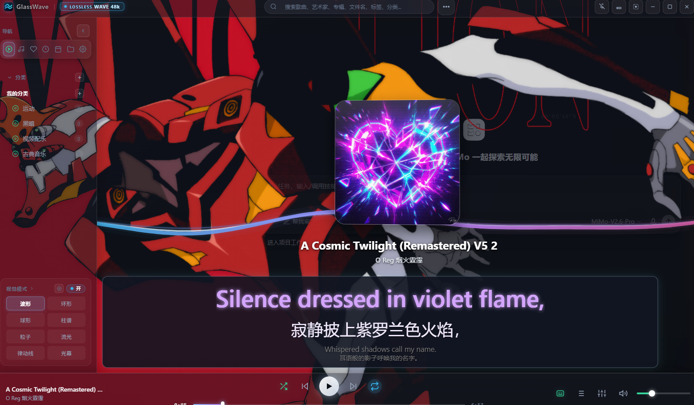

# GlassWave 1.2.8

本次汇总 **1.2.7 → 1.2.8** 之间的全部正式更新：新增五种曲库显示方式、逐层文件夹浏览、四种播放按键风格、视觉响应模式与高刷新选项，并集中修复滚动封面闪烁、全屏切换、搜索播放范围和音频跳转等问题。

**Windows x64 纯净便携版**：下载 `GlassWave-v1.2.8-win-x64.zip`，解压后运行 `GlassWave.exe`。更新已有便携版时，先完全退出播放器，保留原来的 `data` 文件夹。内置 O Reg 的《The Pattern》及专属封面作为示例曲目。

## 新功能与可调整项目

| 项目 | 本版变化与入口 |
| --- | --- |
| 五种曲库显示方式 | “全部歌曲”顶部的“显示”下拉框可选择紧凑列表、大封面列表、小封面网格、大封面网格、全封面卡片。收藏、分类及文件夹内歌曲也可使用，自动记住上次选择。 |
| 大封面列表 | 在保留歌名、艺术家、时长和收藏操作的同时放大封面，适合喜欢列表但希望看清专辑图的场景。 |
| 封面网格与全封面卡片 | 网格按窗口宽度自动调整列数；全封面卡片把图片铺满卡片，歌名和艺术家放在底部渐变区域。正在播放与鼠标多选仍有独立标识。 |
| 文件夹逐层浏览 | 点击侧栏文件夹图标，进入“音乐目录”；点目录卡片或“浏览歌曲”，可进入“第一版、第二版、第三版”等实际子文件夹。提供“上一级”和“全部目录”。 |
| 本层／含子目录 | 默认查看当前文件夹直接包含的歌曲；勾选“含子目录”后把下级歌曲一起显示。文件夹按自然顺序排列，中文“第几版”也按数字顺序处理。 |
| 文件夹播放范围 | 从文件夹里播放歌曲时，下一首与随机播放沿用该文件夹范围；重启后按最新曲库恢复该范围。目录浏览只改变软件中的显示与播放范围。 |
| 四种按键风格 | “系统设置 → 界面配色 → 按键风格”可选荧光线条、轻盈细线、清晰粗线、柔光霓虹；随界面配色和自定义皮肤保存、恢复。 |
| 图标轮廓荧光 | 随机、循环、上一首、下一首的发光沿图标形状显示，移除原来的大块亮底和外圈；播放键保留独立的实心造型。 |
| 按键配色适配 | 继续使用现有“强调 / 进度 / 播放键色”。播放键图标自动反色，浅色面板下的轮廓图标也会检查对比度，避免白底白字。 |
| 均衡器与混响双状态 | 均衡器实际应用非零频段时，音效图标发青蓝色荧光；混响选中有效预设时显示紫色底圈；两者同时生效时叠加显示。悬停显示当前混响名称。 |
| 界面核心元素大小 | 新增封面大小 40%–180%、封面与文字间距 0%–250%、歌名字号 14–48px、艺术家字号 10–30px；提供重置，并随皮肤保存。较小窗口下自动约束封面可用空间。 |
| 黑底／白底边缘柔化 | 背景抠图增加一个综合边缘柔化滑条，协调透明过渡、边缘曲线和轻量羽化。黑底与白底仍保留独立阈值；可保存到皮肤并重置。 |
| 高刷新率选项 | 视觉模式提供 60、90、120、144、180 FPS，以及“跟随屏幕”。默认继续使用 90 FPS；高刷新选项可保存并随皮肤恢复。 |
| 八种视效的响应选择 | 波形、环形、球形、柱谱、粒子、流光、律动线、光幕均可选择原始响应、全频响度、低频、中频、高频、频谱 + 响度、三频分区。各模式独立保存。 |
| 频谱与响度混合 | 选择“频谱 + 响度”后，可调节响度参与比例；三频分区可让不同线条或不同位置分别响应低、中、高频。分析只作用于画面。 |
| 波形流动与振动 | 波形、律动线默认恢复播放与暂停时连续的流动贡献，减少两种状态之间的突兀变化；保留振动时流动保留比例、静音判定和恢复时间等可调项目。 |
| 兼容解码后备路径 | 原生解码失败时，可调用本机 FFmpeg 生成 32 位浮点 PCM 播放缓存。该路径不改写原音频，不进行 MP3/AAC 有损重编码，不强制改变采样率或声道数。详见下方兼容范围。 |

## 曲库、搜索与滚动修复

| 原问题 | 本版处理 |
| --- | --- |
| 轻轻滚动或快速拖动滚动条后，歌曲区域整片变黑 | 移除快速滚动时把全部歌曲行设为透明、停下再淡入的逻辑。滚动中持续更新歌名、艺术家及占位封面。 |
| 各种显示模式中的封面反复闪烁 | 卡片改为按歌曲文件路径保留。仍在渲染范围内的歌曲继续使用原卡片和已解码封面，只回收离开的卡片。 |
| 图片缓存被清理后，已经显示的封面突然退回占位图 | 已显示图片可以继续由当前卡片持有，不因缓存条目被淘汰而擦掉。 |
| 延迟返回的封面贴到滚动后另一首歌上 | 返回时核对卡片当前歌曲及目标封面，防止旧请求污染复用卡片。 |
| 同一专辑的多首歌曲只有第一张封面更新 | 一张封面返回后，更新所有使用该封面的可见歌曲。 |
| 大图解码与大量封面请求影响操作 | 列表单独使用最长边 320px 的缩略图，最多同时加载 3 张；滚动优先文字，图片随后补齐，缓存保持有界。播放页原封面不受缩略图尺寸影响。 |
| 切换列表／网格后当前位置和字母索引失准 | 根据实际列数和卡片高度计算虚拟范围、总高度、当前播放定位与 A–Z 跳转；切换显示方式尽量保留当前浏览位置。 |
| 搜索后清空输入，下一首仍只在搜索结果中选择 | 清空搜索时，同时恢复原来的全部曲库、分类或文件夹播放范围。当前歌曲、媒体源和播放进度保持不变。 |
| 从分类搜索会跳到全部歌曲 | 分类内搜索保留当前分类；文件夹内搜索保留当前文件夹。若在搜索期间手工修改播放队列，清空搜索会保留该安排。 |
| 搜索框或清除按钮点击时左右跳动 | 固定搜索图标、输入区、结果计数与清除按钮的布局槽位。聚焦、输入、清空及结果数量变化不再改变搜索框长度。 |
| 后台刷新把列表推回顶部 | 曲库刷新保留滚动位置；主动搜索和切换页面继续按各自操作定位。 |
| 新增文件频繁触发整库刷新，拖动和滚轮变卡 | 文件事件按路径排队去重，后台事件解析最多并行 2 个；合并保存及通知，界面侧只处理合并后的最新曲库。 |
| 定期扫描对每个目录反复计算整库分类 | 扫描先建立一次目录索引并分批让出执行时间；分类归属改用反向索引，减少重复遍历。 |
| 刷新封面仍使用旧缩略图 | “刷新封面与标签”同时清理列表缩略图缓存。 |

## 音频播放与音量修复

| 原问题 | 本版处理 |
| --- | --- |
| 点一下进度条会重复起音或出现重音 | 按下进入拖动预览，松开只提交一次跳转；快速连续请求只保留最后一个目标。 |
| 跳转、切歌、暂停时的硬切换 | 使用独立输出门控执行短淡出、等待数据就绪、短淡入；正常连续播放期间不反复淡入淡出。 |
| 缓冲未准备好便恢复声音 | 根据音频时钟、跳转事件和媒体就绪状态提交恢复，而非只依赖固定延时；等待过程有上限。 |
| 跳转后混入上一片段的混响尾音 | 跳转或换源时清理当前及正在退出的卷积支路，避免旧尾音拖入新片段。 |
| 音量可能被重复衰减，静音恢复不一致 | 建立音频图后只由输出增益调音量，统一静音状态；音量渐变显式锚定当前值，过滤无效参数。 |
| 均衡器正增益导致失真风险 | 为正增益按频响自动预留电平余量并平滑过渡；平直或旁路时恢复原电平。用户保存的各频段数值不变。 |
| 音频输出上下文报错或意外挂起后不恢复 | 增加设备变化、输出错误及上下文状态监测；仅在本来正在播放时尝试有限恢复，不重置歌曲、进度或队列。 |
| 重复启动可能打开多条播放链 | 同一数据目录使用单实例锁，再次启动唤回原窗口并保留其界面模式。 |
| 慢解码时启动进度恢复过早 | 等待元数据就绪并核对歌曲身份，避免固定延时和旧进度覆盖新歌曲。 |
| 旧兼容解码结果覆盖刚切换的歌曲 | 对照当前歌曲和加载代数；过期结果不替换新歌，也不擅自恢复已经暂停的播放。 |
| 暂停时跳到曲尾仍自动下一首 | 核对实际播放意图，暂停／结束状态不自行续播。 |
| 播放错误没有明确反馈 | 区分操作取消、自动播放权限、读取和解码失败，提供对应提示。 |
| 周期保存状态影响操作 | 去掉已经不用的完整队列路径序列化，只保存小状态；音量和 EQ 改动合并保存，退出时补存。 |
| 滚轮调音量无效或很久后突然生效 | 统一为单一捕获入口，增益立即提交；丢弃积压的过期滚轮事件，按钮与浮层只更新最新反馈。 |
| 音量浮层重复绘制增加负担 | 复用文字和图标，移除浮层对动态背景的额外模糊，减少重复按钮同步；菜单、曲库和歌词设置继续保留自身滚动。 |
| 点击过“下一首”后按空格再次切歌 | 捕获空格的按下和松开，避免焦点按钮合成点击。空格固定播放／暂停；文字输入、输入法组合和快捷键录制仍各按原逻辑处理。 |
| 平直均衡器或仅打开面板就误显示为音效生效 | 点亮依据实际有效参数：总开关开启但全部频段为 0 时不亮；面板可见状态与音效状态独立。 |
| 最小化后的任务栏播放／暂停偶尔不响应 | 任务栏点击单独处理，避免被其他媒体入口的短间隔去重吞掉；最小化、获得焦点和恢复时刷新工具栏。 |
| 播放按钮图标与真实媒体状态不一致 | 以实际媒体暂停／结束状态同步，修正有队列但尚未装载来源时的首次播放；系统媒体状态在命令执行后同步。 |
| Windows 任务栏按钮在深浅主题下对比不足 | 按系统集成界面的深浅主题生成媒体图标。 |

## 视觉、窗口与歌词修复

| 原问题 | 本版处理 |
| --- | --- |
| 高分辨率荧光波形消耗偏大 | 新增 GPU 三线描边路径，复用曲线轮廓、法线和渐变，降低每帧几何上传与重复分配；失败时在同帧回退 Canvas 绘制。波形栅格预算与窗口/DPI 大小分别控制。 |
| 高刷新设置被第二道限帧打断 | 统一由共享动画时钟控制节奏，减少重复限帧；相同帧率设置不再不断重置节奏。 |
| 高刷新使缓慢环境背景也翻倍绘制 | 环境背景保留至多 90Hz 的预算；隐藏／最小化继续暂停动画。 |
| 帧率读数为 0 却显示成 60 | 正确显示实际完成绘制的计数和零值。 |
| 双击全屏／退出时闪烁、短暂截断 | 等窗口尺寸提交后，再统一更新原生裁剪、界面状态和画面；过渡保留已有波形，移除重复通知、淡出和重复退出绑定。 |
| 全屏顶部拖动有时不响应或还原后跳位 | 顶部可拖动区域使用统一拖动路径；达到移动阈值后才还原，并等待恢复尺寸提交后继续跟随鼠标。 |
| 全屏四角残留圆角裁剪，或回窗口后形状不对 | 全屏采用覆盖完整边界的矩形裁剪，窗口状态恢复圆角；相同尺寸状态避免反复重设原生形状。 |
| 窗口圆角边缘不够柔和 | 原生命中区域为界面抗锯齿边缘保留余量，避免把半透明边缘硬切掉。 |
| 搜索框周围及顶部部分空白无法拖动 | 收紧交互控件边界，空白继续允许拖动；搜索输入与实际按钮保持可点击。 |
| 顶部和底部的滚轮音量在非播放页面不一致 | 收藏、最近播放、曲库等页面的公共顶部／底部控制仍可调音量，内容区域按自身滚动规则处理。 |
| 封面增大后歌词被压成很窄的一条 | 封面下方空间不足时，保留可读的歌词框空间，避免通过极小高度挤入大段双语歌词。 |
| 封面、文字调整后皮肤恢复不完整 | 核心元素尺寸随皮肤恢复，重新计算可用封面空间及歌词位置；不重新播放歌曲。 |
| 随机／循环、静音及其他按钮状态难辨 | 统一状态、提示与可访问属性；静音使用划线扬声器，队列、歌词、窗口模式按其实际状态显示。音效按钮采用本版的独立双状态指示。 |

## 兼容范围与说明

- 正常连续播放且音效平直／旁路时，没有默认开启响度归一化、动态压缩器或音色增强。Web Audio 与 Windows 的共享输出仍可能受系统混音、重采样及设备设置影响。
- **未额外附带 FFmpeg 命令行工具。** 原生支持的文件可直接播放；WMA、AIFF、部分 ALAC 等兼容后备路径需要本机已有可用 FFmpeg。缓存受 512MB 容量约束，任务有超时和退出清理，超出或缺少解码器时会提示。
- “跟随屏幕”跟随浏览器及系统合成时钟，不通过定时器无限提交帧。180 FPS 代表目标设置；实际可见帧率受显示器、驱动、窗口大小和画面复杂度影响。
- 文件夹导航显示已入库歌曲对应的目录；不移动源文件。播放队列、分类和显示方式的改变也不改写原音乐文件。

## 验证

159 项自动回归测试通过。隔离播放器使用 6000 条模拟曲目验证五种布局、20 个跳转位置、连续滚轮，以及 900×640、3440×1440、3840×2160 下的布局；验证文件夹搜索、包含子目录和播放范围恢复。

封面闪烁另作连续检查：五种模式各 51 次往返滚动，4580 次已加载封面检查中，仍在范围内的歌曲保持同一张图片节点，图片地址和显示状态不被重设。音频使用合成文件检查播放、跳转、恢复及多种格式路径。这些结果不等同于已验证所有硬件、游戏、驱动与编码文件。

历史界面截图沿用已有资源；新增入口与行为以本页说明为准。

完整历史版本差异索引见 [CHANGELOG](https://github.com/O-Reg/GlassWave/blob/main/CHANGELOG.md)。
